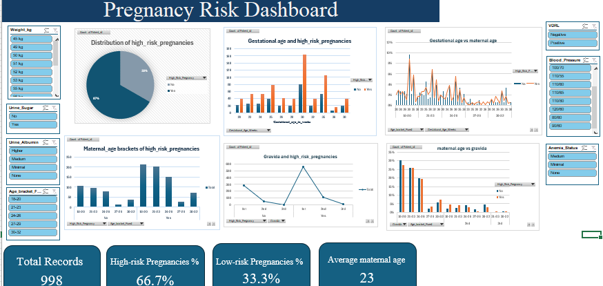

# Maternal Health Risk Analysis

## Project Overview
This project explores the relationship between selected maternal health variables and pregnancy risk classification.

## Problem Statement
The analysis investigates how demographic and antenatal variables relate to the classification of maternal health risk.

## Objectives
1.	To examine the distribution of demographic and clinical variables within the dataset.
2.	To compare antenatal variables between high-risk and low-risk pregnancy categories.
3.	To investigate the association between maternal age and pregnancy risk classification.
4.	To examine the relationship between selected physiological parameters and pregnancy risk classification.
5.	To visualize the observed patterns and communicate the findings through an interactive dashboard.

## Tools Used
- Microsoft Excel
- Pivot Tables
- Charts and Data Visualisation
- Descriptive Statistics

## Analytical Methods
- Descriptive analysis
- Comparative analysis
- Exploratory data analysis

## Dashboard Preview

## Key Findings
High-risk pregnancies were recorded across different gestational ages. The majority of pregnant women in the dataset belonged to the 18–26-year age categories. Primigravida accounted for the highest number of pregnancies and high-risk pregnancy records.

## Limitations
The dataset may not represent the wider population of interest and the accuracy of the findings depends on the quality and completeness of the recorded information.

## Project Files
- Dashboard workbook
- Analysis report
- Dashboard screenshots
## Download Project Files

[Download Excel Dashboard](maternal-health-risk-analysis/pregnancy risk dashboard.xlsx)

[Download Analysis Report](maternal-health-risk-analysis/maternal health dashbaord.docx)
